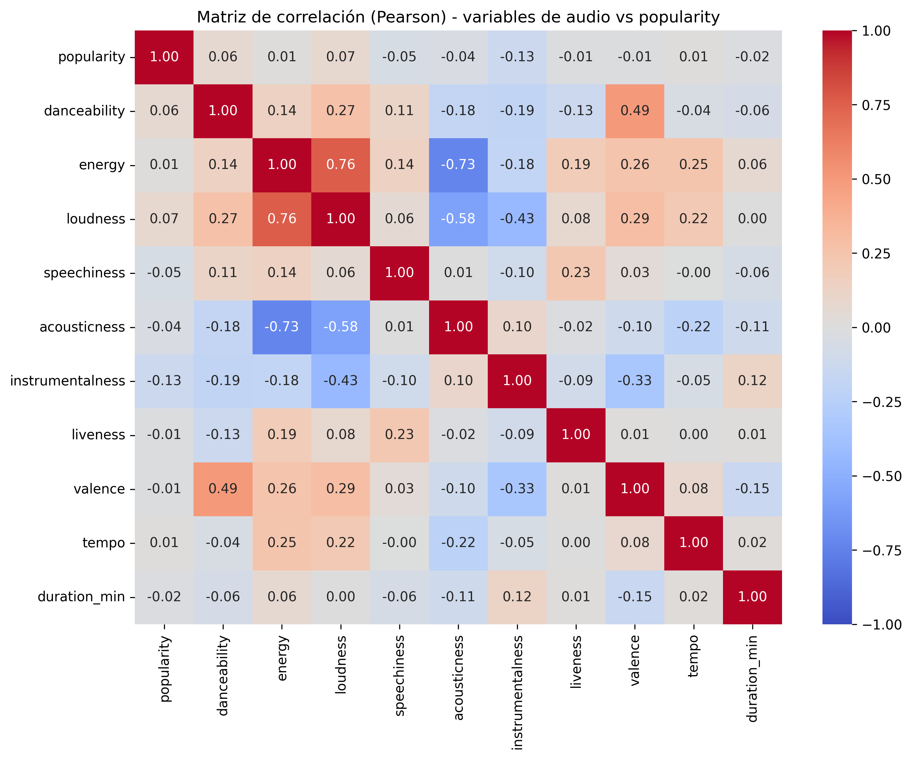
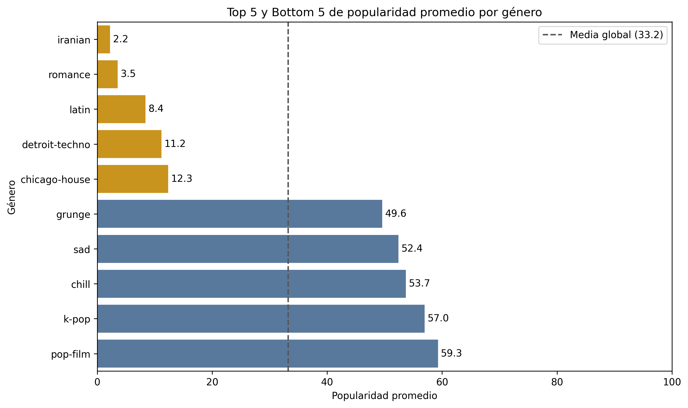
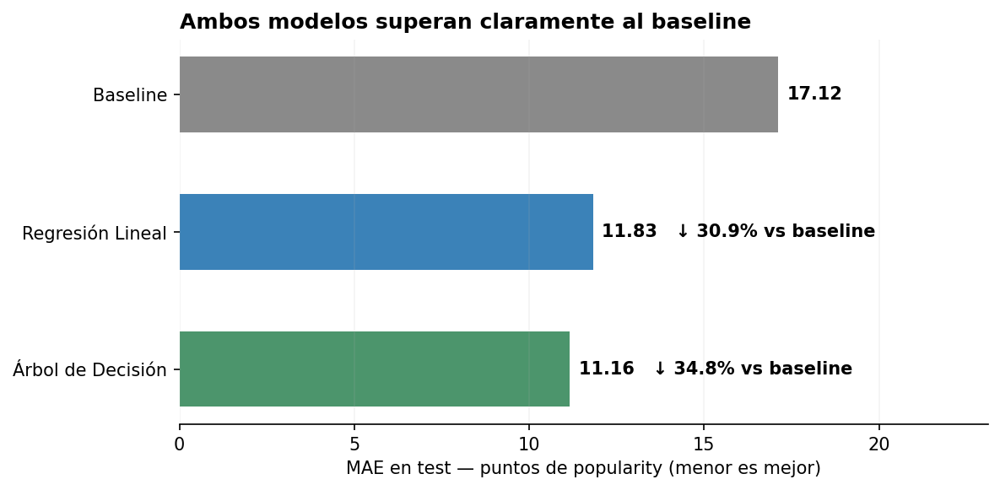
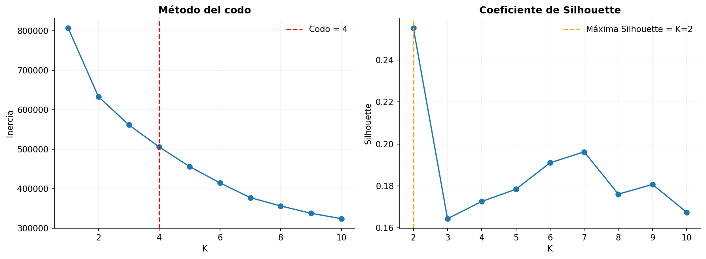
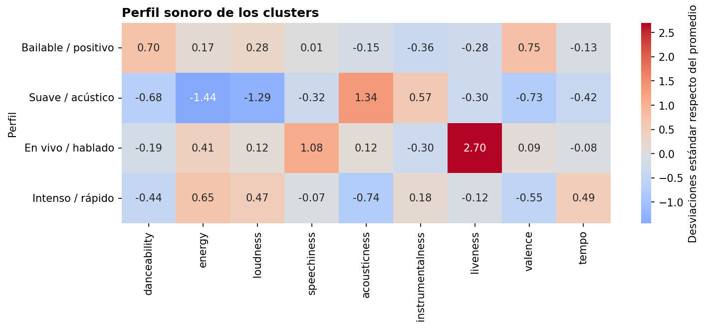
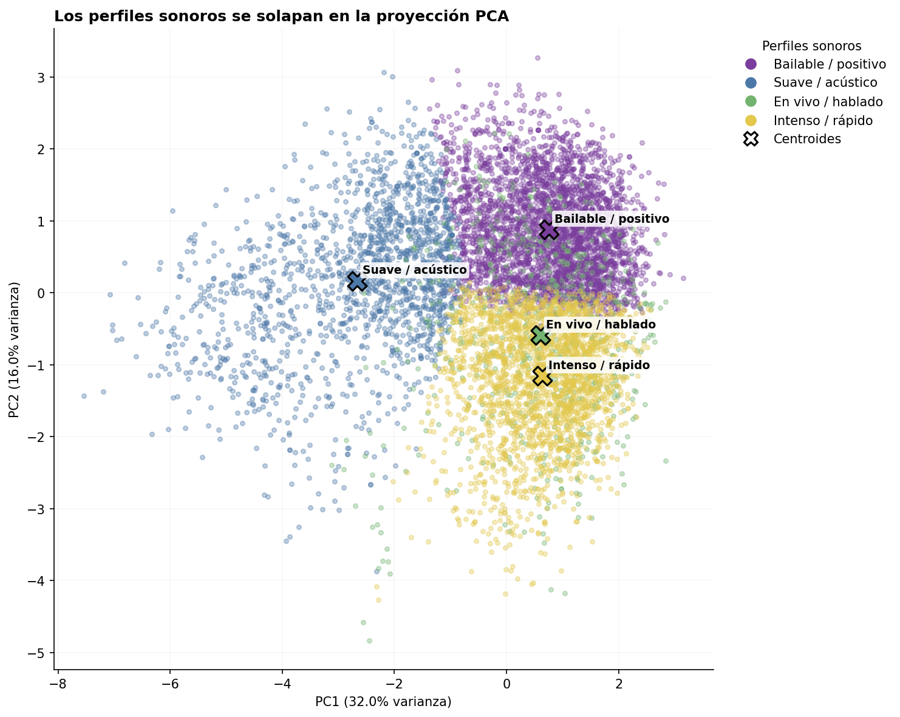

# Proyecto de Machine Learning — Spotify Tracks Dataset

**Asignatura:** MLY1101 — Machine Learning  
**Caso:** C — Inteligencia musical y análisis de popularidad de canciones  
**Formato:** Informe técnico reproducible en Markdown
**Integrantes**:  
   - Diego Torres            
   - Vicente Tapia
   - Cristian Urcullú

---

## 1. Resumen del proyecto

El proyecto analiza el **Spotify Tracks Dataset** con el objetivo de determinar qué información disponible resulta útil para comprender y estimar la `popularity` de las canciones y, de forma complementaria, identificar perfiles sonoros dentro del catálogo.

El trabajo se desarrolló siguiendo CRISP-DM e incluyó comprensión y preparación de los datos, análisis exploratorio, aprendizaje supervisado, aprendizaje no supervisado y evaluación de resultados. Para el aprendizaje supervisado se compararon una **Regresión Lineal** y un **Árbol de Decisión**, utilizando MAE, R² y un baseline como referencia. Para el aprendizaje no supervisado se aplicó **K-Means**, apoyado por el método del codo, Silhouette y PCA.

El principal hallazgo del aprendizaje supervisado fue que **la información utilizada tuvo mayor impacto que el cambio de algoritmo**. Las características de audio y estructura redujeron el MAE solo un **3,5%** respecto del baseline, mientras que incorporar género permitió una reducción cercana al **30,6%**. Con el mismo conjunto combinado de variables, el Árbol de Decisión obtuvo el mejor resultado final, con **MAE = 11,16** y **R² = 0,37**, superando moderadamente a la Regresión Lineal.

En el aprendizaje no supervisado se identificaron cuatro perfiles sonoros descriptivos mediante K-Means. Aunque los grupos presentan una separación limitada —Silhouette cercana a **0,17**—, permiten describir diferencias en características como energía, acústica, baile, valencia, presencia de voz y tempo. Sus niveles de `popularity`, sin embargo, son similares, por lo que estos perfiles resultan más útiles para **describir la diversidad sonora del catálogo** que para distinguir canciones según popularidad.

En conjunto, el proyecto demuestra que el dataset permite realizar una **estimación parcial de la popularidad observada** y obtener información descriptiva sobre el catálogo. Sin embargo, al no contar con una estructura temporal que conecte información previa, decisiones de promoción y resultados posteriores, los modelos desarrollados **no permiten afirmar que puedan anticipar el éxito futuro de una canción ni validar todavía una herramienta real de priorización**.

---

## 2. Problema de negocio, objetivos y KPIs

### 2.1 Problema de negocio

Las plataformas de streaming y otros actores de la industria musical necesitan contar con información que permita comprender mejor el comportamiento de las canciones dentro de sus catálogos y apoyar decisiones relacionadas con promoción y priorización.

En este proyecto se analiza el **Spotify Tracks Dataset** para estudiar qué información disponible sobre una canción permite comprender y estimar su nivel de `popularity`. El análisis considera tanto características musicales y estructurales como información de género.

El alcance del proyecto no corresponde a predecir el éxito futuro de una canción. El dataset no contiene una dimensión temporal que permita diferenciar entre información disponible antes de una decisión de promoción y resultados observados posteriormente. Por ello, el aprendizaje supervisado se utiliza para estimar la `popularity` observada en el conjunto de datos, mientras que el aprendizaje no supervisado se utiliza para identificar perfiles sonoros dentro del catálogo.

### 2.2 Objetivo general y objetivos específicos

**Objetivo general**

Analizar qué información del Spotify Tracks Dataset resulta útil para comprender y estimar la `popularity` de las canciones, utilizando técnicas de aprendizaje supervisado y no supervisado.

**Objetivos específicos**

- Preparar una base de análisis consistente, utilizando una canción identificada por `track_id` como unidad principal.
- Evaluar cuánto aportan las características de audio, la información de género y su combinación para estimar `popularity`.
- Comparar el desempeño de una Regresión Lineal y un Árbol de Decisión utilizando las mismas métricas y condiciones de evaluación.
- Identificar perfiles sonoros mediante K-Means utilizando características de audio.
- Interpretar los resultados considerando sus limitaciones y su posible relación con decisiones de promoción y priorización.

### 2.3 KPIs propuestos y alcance de la evaluación

Si la solución se utilizara posteriormente para apoyar una decisión real de priorización, sería necesario definir previamente cuántas canciones pueden seleccionarse y qué resultado posterior se considerará satisfactorio.

A partir de ello se proponen tres indicadores de negocio:

| KPI propuesto | Qué permitiría evaluar |
|---|---|
| **% de canciones priorizadas que alcanzan el desempeño esperado** | Qué proporción de las canciones seleccionadas obtiene posteriormente el resultado definido por la organización. |
| **% de canciones con buen desempeño que habían sido priorizadas** | Qué proporción de las canciones que finalmente obtienen buen desempeño había sido identificada previamente. |
| **Diferencia frente a una selección de referencia** | Si una selección apoyada por la solución obtiene mejores resultados que otra utilizada como referencia. |

Estos indicadores **no pueden calcularse con el dataset actual**, porque no contiene decisiones reales de promoción ni resultados medidos posteriormente. Por esta razón, durante esta evaluación se utilizan métricas técnicas para comprobar cuánto puede aprenderse con la información disponible, sin presentarlas como KPIs empresariales.

Para los modelos supervisados se utilizan **MAE**, **R²** y comparación con un **baseline**. Para el aprendizaje no supervisado se utilizan **inercia** y **Silhouette**, mientras que PCA se emplea como apoyo para interpretar y visualizar los perfiles obtenidos.

---

## 3. Datos y metodología

### 3.1 Fuente de datos y unidad de análisis

Se utilizó el **Spotify Tracks Dataset**, publicado originalmente en Kaggle por el usuario `maharshipandya` y distribuido en formato CSV. Para mantener la reproducibilidad, el notebook descarga una copia del dataset alojada en el repositorio utilizado por el proyecto.

El archivo original contiene **114.000 registros y 21 columnas**, incluyendo una columna `Unnamed: 0` correspondiente a un índice exportado que no representa una variable del problema.

Entre las variables disponibles se encuentran:

- identificación de la canción: `track_id`, `artists`, `album_name`, `track_name`;
- variable objetivo: `popularity`;
- género: `track_genre`;
- características de audio: `danceability`, `energy`, `loudness`, `speechiness`, `acousticness`, `instrumentalness`, `liveness`, `valence` y `tempo`;
- características estructurales: duración, tonalidad, modo, compás y contenido explícito.

La revisión de los datos mostró que la estructura original no representa únicamente canciones: una misma pista puede aparecer en varias filas cuando está asociada a distintos géneros. Por esta razón se definió como **unidad principal de análisis una canción identificada por un `track_id` único**.

Después de la limpieza y consolidación se construyeron dos estructuras principales:

| Base | Registros | Función |
|---|---:|---|
| `BD_canciones` | **89.740** | Base analítica principal, una fila por `track_id`. |
| `BD_generos` | **113.549** | Conserva las relaciones entre canciones y sus distintos géneros. |

Esta separación evita que una canción tenga mayor peso en el modelamiento simplemente por aparecer asociada a varios géneros, sin perder esa información.

### 3.2 Calidad, preparación y principales hallazgos del EDA

La revisión inicial permitió detectar problemas de calidad y características de la estructura que debían resolverse antes del modelamiento.

Se encontraron **450 registros duplicados reales** que quedaban ocultos al considerar la columna de índice exportada. También se identificó un único registro corrupto, con información faltante de artista, álbum y nombre de canción, además de duración igual a cero. Después de eliminar estos casos, la estructura canción-género quedó compuesta por **113.549 registros válidos**.

La repetición de `track_id` no se consideró un error en sí misma. Se comprobó que corresponde principalmente a canciones asociadas a más de un género; por ello, esta información se conservó en `BD_generos`, mientras que `BD_canciones` consolida cada pista una sola vez.

También se detectaron **720 canciones con más de un valor de `popularity`** en la estructura original. En 673 de ellas la diferencia máxima era de solo un punto, aunque existían algunos casos con diferencias mayores. Como el dataset no contiene una marca temporal que permita decidir cuál observación es la correcta o más reciente, se utilizó la **mediana de `popularity`** para obtener un único valor por canción, manteniendo además el mínimo, máximo, rango y cantidad de valores distintos como información de control.

Los principales hallazgos del EDA fueron:

| Hallazgo | Interpretación y decisión |
|---|---|
| `popularity` presenta media **33,20**, mediana **33** y sesgo **0,07** | La distribución general es cercana a simétrica y no presenta un sesgo marcado. |
| **9.393 canciones (10,5%)** tienen `popularity = 0` | No existe evidencia suficiente para tratarlas como errores, por lo que se conservan. |
| `popularity = 0` aparece en **22,2%** de las canciones asociadas a varios géneros y en **7,9%** de las canciones de un solo género | Existe una asociación con la estructura multigénero, pero no permite afirmar que los ceros sean incorrectos. |
| Se detectaron **4.225 valores atípicos de duración** mediante IQR | Corresponden principalmente a piezas muy breves o mezclas extensas plausibles, por lo que no se eliminan automáticamente. |
| Ninguna característica de audio individual presenta una relación lineal fuerte con `popularity` | La correlación de mayor magnitud corresponde a `instrumentalness` (`-0,127`) y continúa siendo débil. |
| Existen diferencias importantes de `popularity` entre géneros | Pueden aportar información al modelamiento, pero no deben interpretarse como diferencias de calidad musical. |
| Las canciones con contenido explícito presentan una popularidad ligeramente mayor | Existe una amplia superposición entre ambos grupos, por lo que no constituye por sí solo un factor diferenciador fuerte. |
| Existe una alta variabilidad de `popularity` entre canciones de un mismo artista | Incluso entre los **1.663 artistas con al menos 10 tracks únicos** existen casos con una dispersión amplia, por lo que pertenecer al mismo artista no implica niveles similares de popularidad. |

La matriz de correlación confirma que ninguna característica de audio, considerada de manera individual, mantiene una relación lineal fuerte con `popularity`.



La comparación por género mostró diferencias claras en popularidad promedio entre categorías. Este resultado se considera relevante para el modelamiento, pero no implica que un género tenga mayor calidad o que pertenecer a él provoque una determinada popularidad.



Durante la preparación también se realizaron las siguientes transformaciones:

- `duration_ms` se transformó a minutos;
- `mode` se representó mediante nombres interpretables;
- `key` se transformó a su nombre de tonalidad;
- los valores `tempo = 0` se trataron como faltantes;
- `time_signature = 0` se representó como `Unknown`;
- los géneros se representaron mediante columnas binarias, permitiendo que una misma canción pertenezca a más de uno.

Para el modelamiento supervisado, las transformaciones que dependen de los datos se ajustan únicamente con el conjunto de entrenamiento. Esto evita que información del conjunto de prueba influya en la preparación del modelo.

### 3.3 Metodología CRISP-DM

El desarrollo del proyecto se organizó utilizando **CRISP-DM**, manteniendo una relación entre el problema planteado, la comprensión de los datos y el modelamiento posterior.

| Etapa CRISP-DM | Aplicación en el proyecto |
|---|---|
| **Comprensión del negocio** | Definición del problema, objetivos y KPIs propuestos. |
| **Comprensión de los datos** | Revisión de estructura, variables, calidad y análisis exploratorio. |
| **Preparación de los datos** | Limpieza, consolidación por `track_id`, transformación y definición de variables. |
| **Modelado** | Regresión Lineal y Árbol de Decisión para aprendizaje supervisado; K-Means para aprendizaje no supervisado. |
| **Evaluación** | Comparación mediante MAE, R² y baseline en supervisado; inercia y Silhouette en no supervisado. PCA se utiliza como apoyo para interpretar los grupos. |
| **Despliegue** | Fuera del alcance de esta evaluación. |

CRISP-DM no se trató como una secuencia completamente rígida. Los resultados obtenidos durante el análisis y modelamiento permitieron revisar decisiones anteriores, especialmente la importancia de definir correctamente la unidad de análisis y distinguir entre estimar la `popularity` observada y predecir un resultado futuro.

### 3.4 Estrategia de evaluación

Como `popularity` es una variable numérica, el problema supervisado se aborda como **regresión**. La Regresión Lineal se utiliza como un primer modelo para evaluar relaciones lineales y comparar de forma clara cuánto aporta cada conjunto de variables. El Árbol de Decisión se incorpora para comprobar si relaciones no lineales y combinaciones entre variables permiten mejorar esa estimación utilizando la misma información.

Para el aprendizaje supervisado se utilizó una división de **80% de entrenamiento y 20% de prueba**, con `random_state = 29` para mantener reproducibilidad. Como la base contiene una sola fila por `track_id`, una misma canción no puede quedar simultáneamente en entrenamiento y prueba.

El conjunto de prueba se reservó para la evaluación final. La imputación, el escalamiento y la codificación se ajustaron únicamente utilizando los datos de entrenamiento. Cuando fue necesario seleccionar hiperparámetros, como en el Árbol de Decisión, se utilizó validación cruzada dentro del conjunto de entrenamiento.

Antes de comparar modelos se definió un **baseline o referencia base** que predice siempre la mediana de `popularity` del conjunto de entrenamiento. Esto permite determinar si utilizar las características disponibles produce una mejora respecto de una estimación que no aprende relaciones entre variables.

**MAE** se utiliza como métrica principal porque expresa el error promedio directamente en puntos de `popularity`. **R²** se utiliza de forma complementaria para observar qué proporción de la variabilidad consigue representar el modelo.

La evaluación supervisada responde dos preguntas:

1. **¿Qué información aporta a la estimación?**  
   Manteniendo fija la Regresión Lineal, se comparan audio y estructura, género y la combinación de ambos.

2. **¿Qué modelo funciona mejor utilizando la misma información?**  
   Se comparan Regresión Lineal y Árbol de Decisión utilizando el mismo conjunto combinado de variables.

En aprendizaje no supervisado se utiliza el catálogo completo, ya que el objetivo es explorar su estructura y no calcular error de predicción sobre una variable objetivo. K-Means se aplica únicamente sobre características de audio estandarizadas y **`popularity` no participa en la formación ni en la elección de los clusters**.

La **inercia** y el **coeficiente de Silhouette** apoyan la selección e interpretación del número de grupos. **PCA no se utiliza para evaluar el clustering**, sino para representar parte de su estructura en dos dimensiones y facilitar su interpretación.

---

## 4. Resultados de Machine Learning

### 4.1 Aprendizaje supervisado

La evaluación supervisada se organizó primero manteniendo fija la Regresión Lineal y modificando únicamente la información utilizada.

Como referencia se utilizó un baseline que predice siempre la mediana de `popularity`. Su MAE en prueba fue de **17,12 puntos**.

| Información utilizada | MAE test | R² test | Reducción del MAE vs baseline |
|---|---:|---:|---:|
| Baseline (mediana) | 17,117 | ≈ 0,000 | 0,0% |
| Audio + estructura | 16,516 | 0,035 | 3,5% |
| Género | 11,887 | 0,349 | 30,6% |
| Audio + estructura + género | 11,833 | 0,351 | 30,9% |

Las características de audio y estructura mejoran muy poco respecto del baseline. En cambio, al incorporar género el error disminuye de forma considerable. Agregar posteriormente las características de audio sobre el género produce solo una mejora adicional pequeña.

A continuación se comparó la Regresión Lineal combinada con un Árbol de Decisión utilizando exactamente el mismo conjunto de información.

Para el Árbol se realizó una búsqueda de hiperparámetros mediante validación cruzada dentro del conjunto de entrenamiento. La mejor configuración encontrada fue:

- `max_depth = None`
- `min_samples_leaf = 30`

El MAE promedio obtenido durante la validación cruzada fue de **11,47 puntos**.

Los resultados finales fueron:

| Modelo | MAE test | R² test | Reducción del MAE vs baseline |
|---|---:|---:|---:|
| Baseline | 17,117 | ≈ 0,000 | 0,0% |
| Regresión Lineal combinada | 11,833 | 0,351 | 30,9% |
| Árbol de Decisión combinado | **11,159** | **0,368** | **34,8%** |



El **Árbol de Decisión obtiene el mejor desempeño** de los modelos supervisados evaluados. Su mejora sobre la Regresión Lineal existe, aunque es bastante menor que la mejora obtenida al incorporar información de género.

El Árbol presenta además una diferencia mayor entre entrenamiento y prueba:

| Métrica | Entrenamiento | Prueba |
|---|---:|---:|
| MAE | 9,731 | 11,159 |
| R² | 0,517 | 0,368 |

Esto muestra una mayor diferencia entre su desempeño en entrenamiento y prueba. La configuración `min_samples_leaf = 30` limita parte de la complejidad del árbol.

Los errores tampoco se distribuyen de la misma forma en todos los niveles de popularidad. En la Regresión Lineal combinada, las canciones con `popularity = 0` alcanzan un MAE de **24,65**, mientras que para las canciones con valores superiores a cero el MAE es de **10,38**.

Como diagnóstico adicional, la Regresión Lineal produjo **82 predicciones fuera del rango 0–100**, equivalentes aproximadamente al **0,46%** del conjunto de prueba. La predicción mínima fue de `-21,99`, lo que muestra una limitación de utilizar una salida lineal para una variable acotada.

Los coeficientes de la Regresión Lineal y las importancias del Árbol también muestran una presencia relevante de variables de género junto con características de audio y estructura. Estos resultados se utilizan para describir el comportamiento de los modelos y **no como evidencia de que esas variables provoquen cambios en `popularity`**.

### 4.2 Aprendizaje no supervisado

El aprendizaje no supervisado se utilizó para identificar **perfiles sonoros** dentro del catálogo sin utilizar `popularity` ni género para construir los grupos.

K-Means se aplicó sobre nueve características de audio estandarizadas:

`danceability`, `energy`, `loudness`, `speechiness`, `acousticness`, `instrumentalness`, `liveness`, `valence` y `tempo`.

Para elegir el número de clusters se utilizaron dos criterios:

- el **método del codo**, que indicó **K = 4**;
- el **coeficiente de Silhouette**, cuyo valor máximo se obtuvo con **K = 2**.



Aunque el mayor Silhouette se obtuvo con K=2, el método del codo señaló K=4. Se seleccionó **K=4** porque permite describir cuatro perfiles sonoros diferenciables, manteniendo explícitamente que la separación entre ellos es limitada. Por lo tanto, no se presenta K=4 como un número óptimo absoluto, sino como una solución descriptiva adecuada para el objetivo del análisis.

La solución con cuatro clusters obtuvo un **Silhouette aproximado de 0,17**, lo que indica una separación limitada entre los grupos. Los clusters deben interpretarse como perfiles descriptivos con fronteras poco definidas y no como categorías musicales completamente separadas.

Después de revisar las características promedio de cada grupo se asignaron etiquetas descriptivas para facilitar su lectura. Estas etiquetas fueron creadas dentro del proyecto y **no corresponden a categorías oficiales de Spotify ni fueron generadas automáticamente por K-Means**.

| Perfil | Características principales | Canciones | Popularidad media | Mediana |
|---|---|---:|---:|---:|
| **Bailable / positivo** | Mayor `danceability` y `valence` | 36.819 | 34,2 | 35 |
| **Suave / acústico** | Mayor `acousticness`, menor intensidad sonora | 18.601 | 30,4 | 29 |
| **En vivo / hablado** | Mayor `liveness` y `speechiness` | 7.003 | 33,4 | 34 |
| **Intenso / rápido** | Mayor energía y tempo, menor `acousticness` | 27.317 | 33,6 | 33 |



Las diferencias de popularidad entre los cuatro perfiles son pequeñas: sus medias se encuentran aproximadamente entre **30,4 y 34,2 puntos**. Esto indica que la segmentación sonora describe diferencias entre canciones, pero no genera grupos claramente separados por nivel de `popularity`.

Para apoyar la interpretación se utilizó **PCA**, reduciendo las nueve variables originales a dos componentes para poder representar los clusters en un gráfico.

Los dos primeros componentes explican aproximadamente el **48% de la variabilidad total**. El primer componente diferencia principalmente canciones más energéticas y fuertes de aquellas más acústicas e instrumentales. El segundo diferencia principalmente según `danceability` y `valence`, junto con aportes de otras características.



La visualización muestra que **Suave / acústico** aparece relativamente más diferenciado, mientras que **Bailable / positivo**, **En vivo / hablado** e **Intenso / rápido** presentan mayor superposición. El perfil En vivo / hablado es además el grupo más pequeño, con aproximadamente **7,8%** de las canciones.

En conjunto, el aprendizaje no supervisado permitió identificar una organización interpretable del catálogo según sus características de audio, pero la baja separación entre clusters obliga a mantener una interpretación descriptiva y no rígida.

---

## 5. Interpretación para el problema de negocio

### 5.1 Qué información aporta realmente el dataset

Los resultados muestran que **no toda la información disponible aporta lo mismo para estimar `popularity`**.

Las características de audio y estructura, utilizadas sin información de género, producen una mejora pequeña respecto del baseline. En cambio, al incorporar género, el error disminuye de forma mucho más marcada y el R² aumenta considerablemente. Agregar después las características de audio sobre el género produce solo una mejora adicional pequeña.

Esto permite concluir que, dentro de este dataset, **la información de género concentra gran parte de la capacidad disponible para estimar `popularity`**.

El resultado también muestra que el desempeño no depende únicamente del algoritmo. El cambio producido al incorporar género fue mucho mayor que la mejora posterior obtenida al pasar de Regresión Lineal a Árbol de Decisión.

Por lo tanto, antes de aumentar la complejidad de los modelos, resulta más relevante preguntarse **qué información está disponible y qué relación tiene realmente con el problema que se quiere resolver**.

El género debe interpretarse con cautela. Las diferencias observadas describen asociaciones presentes en este conjunto de datos, pero no permiten concluir que pertenecer a un género provoque mayor o menor popularidad.

### 5.2 Qué aportan los modelos supervisados

Entre los dos modelos evaluados con la misma información, el **Árbol de Decisión obtiene el mejor desempeño**, con un MAE aproximado de **11,16 puntos** y un R² de **0,37**. La Regresión Lineal combinada alcanza un MAE cercano a **11,83** y un R² de **0,35**.

El mejor desempeño del Árbol **sugiere que existen relaciones no lineales o combinaciones entre variables que la Regresión Lineal no logra representar completamente**. Aun así, la diferencia entre ambos modelos es moderada en comparación con el efecto producido por incorporar información de género.

El resultado más relevante no es simplemente que el Árbol obtenga la mejor métrica, sino que:

> **Cambiar la información disponible produjo una mejora mucho mayor que cambiar el algoritmo manteniendo la misma información.**

Además, el R² del mejor modelo continúa alrededor de **0,37**. El modelo representa una parte de las diferencias observadas en `popularity`, pero una proporción importante permanece sin explicar.

Los errores tampoco son uniformes. Las canciones con valores extremos de popularidad presentan mayores dificultades, especialmente aquellas con `popularity = 0`.

Por ello, los modelos actuales son útiles para **analizar cuánto puede aprenderse de la información disponible**, pero sus estimaciones no deberían tratarse como valores exactos ni utilizarse como único criterio para una decisión de promoción.

### 5.3 Qué aportan los perfiles sonoros

El aprendizaje no supervisado entrega una conclusión distinta, pero complementaria.

Las características de audio tuvieron poca capacidad para estimar `popularity`, pero esto **no significa que carezcan de información útil**. Al utilizar K-Means sobre estas variables fue posible identificar perfiles sonoros diferentes dentro del catálogo.

Sin embargo, la solución presenta un Silhouette cercano a **0,17**, por lo que los grupos se encuentran parcialmente superpuestos. El PCA refuerza esta lectura: permite observar una organización reconocible, pero no una separación completa.

Además, la popularidad media de los cuatro perfiles es relativamente similar.

Por lo tanto, los clusters son útiles principalmente para **describir la diversidad sonora del catálogo**, no para separar canciones populares de canciones poco populares.

Este resultado complementa al aprendizaje supervisado:

> **El audio aporta poco para estimar `popularity`, pero sí permite describir cómo se organiza el catálogo según características sonoras.**

No existe contradicción entre ambos resultados, porque cada técnica responde una pregunta distinta.

### 5.4 Qué puede y qué no puede concluirse para el negocio

A partir de los resultados actuales sí puede concluirse que el dataset contiene información útil para estimar parcialmente la `popularity` observada y que **el género aporta mucho más a esa estimación que las características de audio utilizadas**.

También puede concluirse que las características de audio permiten describir distintos perfiles sonoros, aunque estos presentan fronteras poco definidas y niveles de popularidad relativamente similares.

Sin embargo, los resultados actuales **no validan todavía una herramienta real de priorización de canciones**. El dataset no contiene información que permita conectar una decisión previa de promoción con un resultado posterior.

Por ello, los modelos no demuestran que puedan anticipar qué canciones serán populares en el futuro ni que utilizar sus estimaciones mejore por sí solo una campaña o una decisión de promoción.

La división aleatoria estima el desempeño sobre canciones no utilizadas durante el entrenamiento, pero pertenecientes a la misma distribución del dataset; **no constituye una evaluación sobre canciones futuras**.

---

## 6. Limitaciones y consideraciones éticas

### 6.1 Limitaciones de los datos y del modelamiento

Los resultados obtenidos permiten evaluar cuánto puede aprenderse a partir del dataset disponible, pero existen varias limitaciones que restringen su interpretación.

| Limitación | Implicación |
|---|---|
| `popularity` corresponde a una observación del momento de extracción | El modelo estima la popularidad observada, pero no demuestra capacidad para anticipar popularidad futura. |
| **720 canciones** presentan más de un valor de `popularity` para el mismo `track_id` | Fue necesario consolidar estos casos mediante la mediana antes del modelamiento. |
| El mejor modelo alcanza **R² ≈ 0,37** | Una parte importante de las diferencias observadas en `popularity` permanece sin explicar. |
| Los errores son mayores en valores extremos, especialmente en `popularity = 0` | El desempeño promedio del modelo no representa de igual forma todos los tipos de canciones. |
| La división entrenamiento/prueba es aleatoria | No permite comprobar desempeño sobre canciones lanzadas posteriormente. |
| K-Means alcanza **Silhouette ≈ 0,17** | Los perfiles presentan superposición y no deben interpretarse como categorías rígidas. |
| Los dos componentes de PCA explican aproximadamente **48%** de la variabilidad | La visualización en dos dimensiones no representa toda la información utilizada por K-Means. |

Estas limitaciones son especialmente importantes para el objetivo de negocio. El dataset no registra una secuencia del tipo **información disponible → decisión de promoción → resultado posterior**.

Por esta razón, aumentar directamente la complejidad del algoritmo no aparece como la principal prioridad. Los resultados muestran que **la información disponible tuvo un efecto mucho mayor que el cambio entre Regresión Lineal y Árbol de Decisión**.

### 6.2 Consideraciones éticas

La variable `popularity` representa comportamiento de consumo registrado dentro de Spotify. Por lo tanto, **no debe interpretarse como una medida objetiva de calidad musical, valor artístico o valor cultural**.

Este punto adquiere especial importancia porque el género fue una de las fuentes de información que más aportó al modelo. Durante el EDA se observaron diferencias importantes de popularidad entre géneros y, posteriormente, los modelos supervisados aprendieron asociaciones similares.

Sin embargo, estas asociaciones **no demuestran que pertenecer a un género provoque mayor o menor popularidad**. Las diferencias observadas pueden estar relacionadas con la composición del dataset, la representación, la exposición o la presencia de Spotify en distintos mercados, pero estos datos no permiten identificar cuál de esos factores explica el resultado.

Esto genera un riesgo para cualquier utilización posterior: un modelo que aprende a partir de diferencias ya presentes en los datos puede volver a utilizarlas al generar estimaciones. Sin embargo, el análisis realizado **no demuestra que el modelo perjudique sistemáticamente a un género específico**, ya que no se realizó una evaluación de errores por género orientada a comprobar ese punto.

Por ello, las estimaciones no deberían utilizarse como una medida de calidad musical, como criterio para valorar culturalmente un género o artista, ni como único criterio para decidir qué canciones promocionar o descartar.

La misma precaución se aplica a los clusters: los nombres **Bailable / positivo**, **Suave / acústico**, **En vivo / hablado** e **Intenso / rápido** son etiquetas descriptivas asignadas después de revisar las características promedio de cada grupo. No representan categorías oficiales de Spotify ni etiquetas generadas automáticamente por K-Means.

---

## 7. Conclusiones y próximos pasos

El proyecto permitió evaluar, mediante aprendizaje supervisado y no supervisado, qué tipo de información del Spotify Tracks Dataset resulta realmente útil para analizar `popularity` y describir el catálogo.

En aprendizaje supervisado, el hallazgo principal no fue únicamente que el **Árbol de Decisión** obtuviera el mejor resultado, con **MAE = 11,16** y **R² = 0,37**, sino que **la incorporación del género produjo una mejora mucho mayor que el cambio de algoritmo**.

El aprendizaje no supervisado aportó una conclusión complementaria. Aunque las características de audio tienen poca capacidad para estimar `popularity`, sí permiten identificar **perfiles sonoros interpretables** dentro del catálogo. Estos perfiles presentan una separación limitada y niveles de popularidad similares, por lo que su utilidad principal es descriptiva.

En conjunto, los resultados permiten afirmar que el dataset contiene información suficiente para realizar una **estimación parcial de la popularidad observada** y describir la organización sonora del catálogo, pero no para validar todavía una herramienta que anticipe y mejore decisiones reales de promoción.

El siguiente avance debería centrarse principalmente en **mejorar los datos y la forma de evaluar el problema**, antes que en aumentar automáticamente la complejidad del algoritmo.

Una etapa posterior podría incorporar información disponible antes de una decisión, como fecha de lanzamiento, exposición en playlists, información de promoción o antecedentes de audiencia, y registrar posteriormente el resultado obtenido. Con una estructura de este tipo sería posible comprobar directamente los KPIs de priorización definidos al inicio del proyecto.

> **Conclusión final:** el dataset permite estimar parcialmente la `popularity` observada y describir perfiles sonoros, pero el principal límite actual no es solamente el algoritmo, sino la información disponible y la ausencia de datos temporales que conecten una decisión con su resultado posterior.

---

## 8. Reproducción del proyecto

El proyecto está preparado para ejecutarse tanto en Google Colab como en un entorno local de PC, utilizando el mismo notebook. Al iniciarse, detecta la raíz del proyecto y utiliza las carpetas data/, images/ y models/.

Si el dataset está disponible en data/Spotify_Tracks_Dataset.csv, se utiliza directamente. En caso contrario, se descarga automáticamente desde el repositorio.

**Reproducir el proyecto en PC**:

1. Clonar o descargar el repositorio.
2. Instalar las dependencias desde la raíz del proyecto:
> python -m pip install -r requirements.txt
3. Abrir notebooks/Eva2_Spotify.ipynb en VS Code o Jupyter.
4. Seleccionar el entorno de Python, reiniciar el kernel y ejecutar todas las celdas.

**Reproducir el proyecto en Google Colab**:

1. Abrir notebooks/Eva2_Spotify.ipynb en Google Colab.
2. Reiniciar el entorno de ejecución.
3. Ejecutar todas las celdas.

Se utiliza `random_state = 29` en los procesos que requieren aleatoriedad, permitiendo mantener resultados reproducibles entre ejecuciones.

La estructura esperada del proyecto es:

```text
spotify_track_dataset/
├── README.md
├── requirements.txt
├── data/
│   └── Spotify_Tracks_Dataset.csv
├── notebooks/
│   └── Eva2_Spotify.ipynb
├── images/
│   └── Gráficos generados
├── models/
│   └── Modelos y métricas
└── report/
    ├── Informe_Tecnico_Spotify_EP1.md
    └── Informe_Tecnico_Spotify_EVA2.md
```

El notebook fue comprobado desde un entorno reiniciado y puede ejecutarse completamente sin intervención manual durante el flujo de análisis.

El guardado de modelos y métricas facilita la reproducción y revisión del proyecto, pero **no corresponde a un despliegue del modelo**.

## 9. Matriz de responsabilidades del equipo

La siguiente matriz define las responsabilidades para la **integración, revisión final y defensa del proyecto**. Su objetivo es dejar claro quién lidera cada área y quién participa en su validación antes de la entrega.

| Actividad | Cristian Urcullú | Diego Torres | Vicente Tapia |
|---|---|---|---|
| Integración técnica del notebook y reproducibilidad | Participa | Participa | Revisión |
| Preparación de datos y EDA | Participa | Revisión | Participa |
| Modelamiento supervisado y evaluación | Participa | Participa | Revisión |
| K-Means, PCA e interpretación de perfiles | Participa | Revisión | Participa |
| Integración y redacción del informe técnico | Participa | Revisión | Revisión |
| Revisión de consistencia entre notebook, informe y resultados | Coordina | Participa | Participa |
| Presentación y defensa técnica | Participa | Participa | Participa |
| Revisión final del repositorio y archivos de entrega | Responsable principal | Revisión | Revisión |

Esta distribución permite que la integración técnica quede centralizada, mientras que la revisión de resultados y la defensa final sean compartidas por los tres integrantes.